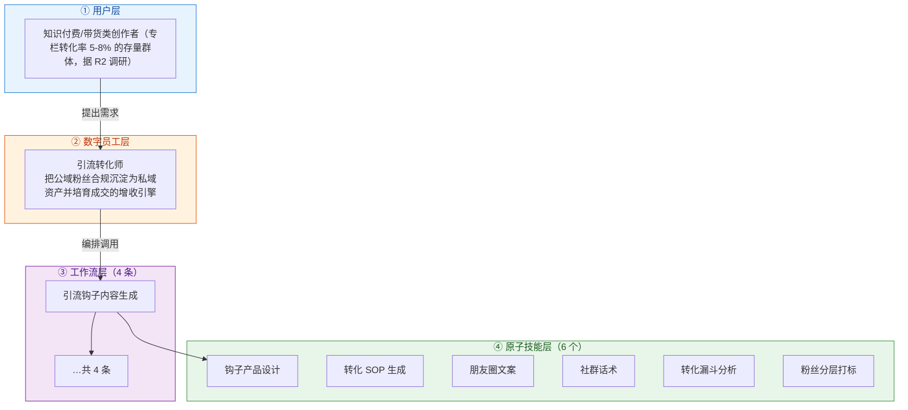
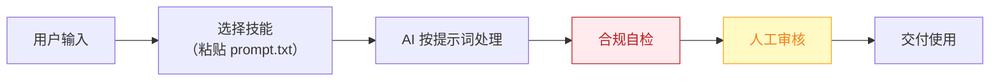

# 引流转化师 — 业务架构

## 四层视图

## 资产形态说明

本资产包为**纯提示词客户端资产**：

| 特性 | 说明 |
|------|------|
| 无运行时依赖 | 不调用任何模型 API，不需要 API Key |
| 平台无关 | 提示词为纯文本，可导入任意主流 AI 平台 |
| 用户自备算力 | 模型由用户自己的订阅提供 |
| 零服务端成本 | 资产方不产生任何调用费用 |

## 数据流

> **关键设计**：所有对外输出必须经过「合规自检 → 人工审核」双闸门。

## 能力边界

| 维度 | 内容 |
|------|------|
| **目标用户** | 知识付费/带货类创作者（专栏转化率 5-8% 的存量群体，据 R2 调研） |
| **做** | 钩子设计、培育 SOP、私域内容日历、成交话术 |
| **不做** | 不做：承诺转化率、代用户收款/签约、不设计任何违反平台导流规则的"硬引流"话术 |
| **KPI** | 私域添加率提升（相对基线）；7 天培育 SOP 完成率；转化率从 <1% 基线（据 R2 调研）向 2-3% 区间爬坡 |
| **定价** | ¥100-300/月（直接关联收入，知识付费创作者可承受，据 R2 调研；R5 调研交叉印证私域类为付费旗舰） |

---

*本图由 build_p0_assets.py 自动生成*
