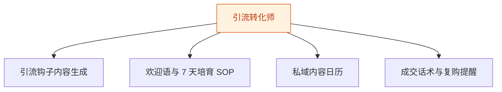
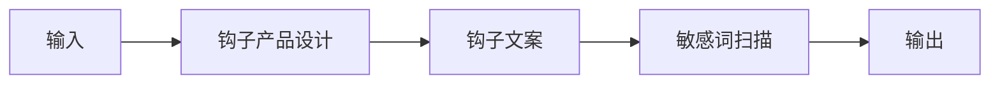
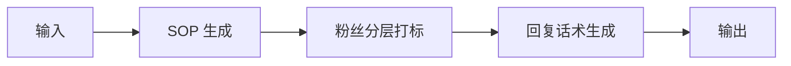
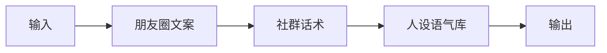
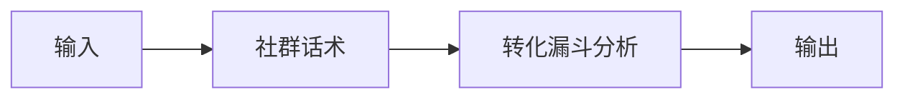

# 引流转化师 — 工作流流程图

本员工共 **4 条工作流**，下辖 **6 个原子技能**。

## 总览

## 分条详情

### 引流钩子内容生成

| 项目 | 内容 |
|------|------|
| 触发 | 人工（按活动） |
| 复杂度 | `S` |
| 阶段 | `P1` |
| ROI | 钩子设计外包市场价数百元/次，自产即省 |

### 欢迎语与 7 天培育 SOP

| 项目 | 内容 |
|------|------|
| 触发 | 事件（新粉加入） |
| 复杂度 | `M` |
| 阶段 | `P1` |
| ROI | 替代人工逐一维护，月省约 15h；转化率每 +1pct 对知识付费创作者即数百元月增收 |

### 私域内容日历

| 项目 | 内容 |
|------|------|
| 触发 | 定时（每周） |
| 复杂度 | `S` |
| 阶段 | `P1` |
| ROI | 私域内容 0.5h/天→10min，月省约 10h≈¥300 |

### 成交话术与复购提醒

| 项目 | 内容 |
|------|------|
| 触发 | 事件（转化节点/沉睡唤醒） |
| 复杂度 | `M` |
| 阶段 | `P2` |
| ROI | 直接关联收入：唤醒一单即覆盖全年订阅费 |

## 汇总表

| # | 工作流 | 阶段 | 复杂度 | 触发 | 涉及技能数 |
|---|--------|------|--------|------|-----------|
| 1 | 引流钩子内容生成 | `P1` | `S` | 人工（按活动） | 3 |
| 2 | 欢迎语与 7 天培育 SOP | `P1` | `M` | 事件（新粉加入） | 3 |
| 3 | 私域内容日历 | `P1` | `S` | 定时（每周） | 3 |
| 4 | 成交话术与复购提醒 | `P2` | `M` | 事件（转化节点/沉睡唤醒） | 2 |

---

*本图由 build_p0_assets.py 自动生成*
