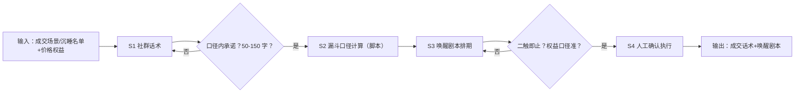

# 成交话术与复购提醒

## 元信息

| 字段 | 值 |
|------|-----|
| ID | `de_media_04_wf04` |
| 类型 | **`composite`（复合技能）** |
| 所属员工 | 引流转化师 |
| 阶段 | `P2` |
| 复杂度 | `M` |
| 触发方式 | 事件（转化节点/沉睡唤醒） |
| ROI | 直接关联收入：唤醒一单即覆盖全年订阅费 |
| 资产形态 | 提示词编排 + Python 编排脚本（run_flow.py，无 API Key） |

> 复合技能 = 工作流。它把多个**原子技能**按业务顺序编排在一起，完成一个完整场景。

## 能力描述

把成交与复购两个节点推进到「可直接执行」，四步走：

1. **S1 社群话术**：成交咨询节点（课程对比/权益确认/犹豫观望）话术各 1 条，50-150 字，承诺落在授权口径内
2. **S2 转化漏斗分析**（脚本承担）：从名单规模与价格权益算确定性口径——年课实付 = 年课价 − 抵扣额（如 4999 − 399 = 4600 元），窗口天数以权益条款为准
3. **S3 唤醒剧本**：沉睡名单按周排期（W1 触达 100% 覆盖 → W2 到期倒计时），节奏「二触即止」，二触无响应转朋友圈被动触达
4. **S4 人工确认**：话术与权益口径经运营确认后执行；减免/赔付类诉求一律升级人工

## 编排的原子技能

| # | 原子技能 | 能力 |
|---|---------|------|
| 1 | [社群话术](../../skills/community-script/) | 社群活跃/成交/唤醒话术 |
| 2 | [转化漏斗分析](../../skills/funnel-analysis/) | 添加→培育→成交各环节转化诊断 |

## 步骤链路（DAG）



## 步骤明细

| # | 步骤 | 技能资产 | 输入 | 输出 | 失败处理 |
|---|------|---------|------|------|---------|
| 1 | 社群话术 | [`../../skills/community-script/`](../../skills/community-script/) | 成交场景+课程信息 | 节点话术 3 条 | 口径外承诺退回；金额类升级人工 |
| 2 | 漏斗口径计算 | [`../../skills/funnel-analysis/`](../../skills/funnel-analysis/) + 本流脚本 | 价格与权益条款 | 实付口径表 | 条款缺失中止，不估算权益 |
| 3 | 唤醒剧本 | 本流脚本 | 沉睡名单规模+窗口 | 按周排期 4 波次 | 无窗口天数按 14 天并标注假设 |
| 4 | 人工确认 | （人工） | 话术+剧本 | 可执行方案 | 口径与红线复核后才执行 |

## 步骤说明

漏斗定位→节点话术→沉睡名单唤醒剧本→人工确认

## 输入规格

| 字段 | 类型 | 必填 | 说明 |
|------|------|------|------|
| `input` | string | ✅ | 工作流初始输入：成交场景（用户咨询原文）或沉睡名单（人数、结课状态）、课程价格信息、可用续报权益（抵扣额与窗口天数） |

## 输出规格

| 字段 | 类型 | 说明 |
|------|------|------|
| `summary` | string | 执行摘要（话术条数、红线通过率、唤醒波次数） |
| `steps` | array | 分步结果（每步资产、输出与量化验收） |
| `deliverable` | string | 最终交付物：价格权益口径表 + 成交话术 + 唤醒剧本 |
| 产物 | file | `out/成交唤醒交付物.md`、`out/唤醒剧本.csv`、`out/flow_result.json` |

## 错误处理

| 情况 | 处理方式 |
|------|---------|
| 输入缺价格或权益条款 | 提示缺少的字段，终止流程，不估算权益 |
| 话术出现承诺红线词 | 拦截改写后复检，0 命中才通过 |
| 用户诉求超出授权（减免/赔付） | 升级人工，2 小时内响应 |
| 沉睡名单已二触无响应 | 停止私聊打扰，转朋友圈被动触达 |

## 验收标准

- [ ] 价格权益口径为脚本计算（实付 = 年课价 − 抵扣额），与官方口径核对一致
- [ ] 成交话术 50-150 字、口径内承诺、红线扫描 0 命中
- [ ] 唤醒剧本 W1 覆盖率 100%、节奏二触即止
- [ ] 全部输出带 AI 生成标识并经人工确认

## 使用步骤

### 方式一：纯提示词编排（跨平台）

1. 把 `prompt.txt` 全文粘贴为系统提示词
2. 提供成交场景或沉睡名单与价格权益信息
3. 按 S1→S2→S3 顺序产出并自检
4. 实付口径与名单规模用下方脚本实测，不靠口算

### 方式二：带脚本（端到端产物）

```bash
python <WF_DIR>/scripts/run_flow.py --input examples/input.json --outdir out
python <WF_DIR>/scripts/run_flow.py --demo   # 无输入也能看效果
```

**分工**：脚本做**权益口径计算、唤醒排期生成、红线词扫描、产物落盘**；模型做**话术语境化润色、异议处理**。数值口径以脚本输出为准。

## 调用示例

**输入**（`examples/input.json`，真实实跑数据）：场景一家长咨询年课与系统课区别及优惠；场景二 83 名结课 30 天未续报家长唤醒。体验课 399 元 / 年课 4999 元 / 系统课 3299 元，结课后 14 天内抵扣 399 元。

**输出**（脚本实跑）：成交话术 3 条（红线通过 3/3）、唤醒剧本 4 波次。

| 项目 | 口径 |
|---|---|
| 续报权益 | 结课后 14 天内抵扣 399 元 |
| 年课实付 | 4600 元 |
| W1 验收 | 触达覆盖率 100% |

## 边界（不做的事）

- ❌ 不擅自承诺价格减免、赔付——此类 100% 升级人工
- ❌ 不估算权益——条款缺失时中止并索要原文
- ❌ 不无限触达——二触无响应停止主动私聊
- ❌ 不保证唤醒率或续报率——只给执行节奏与验收指标
- ❌ 不跳过人工确认执行

## 在平台上的编排方式

| 平台 | 编排方式 |
|------|---------|
| **Coze / 扣子** | 新建工作流 → 按步骤添加节点，每个节点填入对应技能的 prompt.txt |
| **Dify** | 新建 Workflow → 添加 LLM 节点链，按 DAG 顺序连接 |
| **WorkBuddy** | 新建 Skill，按步骤在指令中串联各技能提示词 |
| **手动使用** | 按步骤顺序，逐个把 prompt.txt 与上一步输出交给 AI |

## 所属工作流

本资产为复合技能（工作流），是私域链路的成交收口：上游接
`welcome-7day-nurture-sop-flow`（新粉培育）与 `private-domain-calendar-flow`（内容排期）。

## 合规声明

- 输出标注「AI 生成内容」；发送前必须经运营人工确认
- 价格与权益以官方口径为准，不擅自承诺；减免/赔付类诉求升级人工
- 触达频次遵守平台规则；用户名单属个人信息，不对外披露明细
- 涉及资金的输出仅生成草稿，不执行写操作
