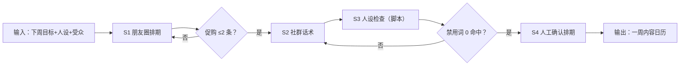

# 私域内容日历

## 元信息

| 字段 | 值 |
|------|-----|
| ID | `de_media_04_wf03` |
| 类型 | **`composite`（复合技能）** |
| 所属员工 | 引流转化师 |
| 阶段 | `P1` |
| 复杂度 | `S` |
| 触发方式 | 定时（每周） |
| ROI | 私域内容 0.5h/天→10min，月省约 10h≈¥300 |
| 资产形态 | 提示词编排 + Python 编排脚本（run_flow.py，无 API Key） |

> 复合技能 = 工作流。它把多个**原子技能**按业务顺序编排在一起，完成一个完整场景。

## 能力描述

把下一周业务目标落成「可发布的私域内容排期」，四步走：

1. **S1 朋友圈文案**：一周 7 天排期（价值/人设/互动/促购四类），促购 ≤2 条/周，促购条带唯一行动指令，正文 120-200 字
2. **S2 社群话术**：关键节点（上架/互动征集/截止提醒）群话术，每条 50-120 字，直接可复制发送
3. **S3 人设语气库**（脚本承担）：称呼统一检查 + 禁用词扫描（最好/第一/100% 等 8 类），命中即改写
4. **S4 人工确认**：日历与话术经运营确认后排入发布工具，周日复盘下周迭代

## 编排的原子技能

| # | 原子技能 | 能力 |
|---|---------|------|
| 1 | [朋友圈文案](../../skills/moments-copy/) | 人设一致的朋友圈内容批量产出 |
| 2 | [社群话术](../../skills/community-script/) | 社群活跃/成交/唤醒话术 |
| 3 | [人设语气库](https://github.com/bangwozuo/script-writer-zh/tree/main/skills/persona-voice-library/)（跨仓技能） | 沉淀用户语气、口头禅、禁用词 |

## 步骤链路（DAG）



## 步骤明细

| # | 步骤 | 技能资产 | 输入 | 输出 | 失败处理 |
|---|------|---------|------|------|---------|
| 1 | 朋友圈排期 | [`../../skills/moments-copy/`](../../skills/moments-copy/) | 下周目标+人设 | 7 天排期表 | 促购 >2 条合并；无数字依据的卖点删除 |
| 2 | 社群话术 | [`../../skills/community-script/`](../../skills/community-script/) | 排期+节点 | 节点话术 3-5 条 | 超 120 字拆条；口径外承诺退回 |
| 3 | 人设检查 | 人设语气库（跨仓）+ 本流脚本 | 全部话术 | 一致性核查结论 | 禁用词命中改写复检 |
| 4 | 人工确认 | （人工） | 日历+话术 | 排期定稿 | 未确认不得发布 |

## 步骤说明

朋友圈+社群内容排期→人设文案→发送提醒→人工确认

## 输入规格

| 字段 | 类型 | 必填 | 说明 |
|------|------|------|------|
| `input` | string | ✅ | 工作流初始输入：排期周期（起止日期）、人设（名称与身份）、受众（群与人数）、本周业务目标（课程/活动/价格/截止时间） |

## 输出规格

| 字段 | 类型 | 说明 |
|------|------|------|
| `summary` | string | 执行摘要（排期条数、促购条数、话术条数、核查通过率） |
| `steps` | array | 分步结果（每步资产、输出与量化验收） |
| `deliverable` | string | 最终交付物：一周日历 + 社群话术 + 人设检查结论 |
| 产物 | file | `out/内容日历交付物.md`、`out/内容日历.csv`、`out/flow_result.json` |

## 错误处理

| 情况 | 处理方式 |
|------|---------|
| 输入缺周期/人设/目标 | 提示缺少的字段，终止流程 |
| 促购条数超 2 条/周 | 合并为一条或移入社群话术 |
| 禁用词命中 | 改写后重新扫描，0 命中才通过 |
| 时间信息冲突（上架/截止） | 以输入为准逐条核对，冲突时中止确认 |

## 验收标准

- [ ] 一周排期 7 条、促购 ≤2 条、四类内容覆盖
- [ ] 促购内容含价格、截止时间与唯一行动指令
- [ ] 社群话术 50-120 字、禁用词 0 命中
- [ ] 全部内容带 AI 生成标识并经人工确认

## 使用步骤

### 方式一：纯提示词编排（跨平台）

1. 把 `prompt.txt` 全文粘贴为系统提示词
2. 提供下周周期、人设、受众与业务目标
3. 按 S1→S2→S3 顺序产出并自检
4. 促购频次与禁用词扫描用下方脚本实测

### 方式二：带脚本（端到端产物）

```bash
python <WF_DIR>/scripts/run_flow.py --input examples/input.json --outdir out
python <WF_DIR>/scripts/run_flow.py --demo   # 无输入也能看效果
```

**分工**：脚本做**排期骨架生成、促购频次控制、话术组装、禁用词扫描、产物落盘**；模型做**文案语境化润色、热点借势**。频次与核查结果以脚本输出为准。

## 调用示例

**输入**（`examples/input.json`，真实实跑数据）：2026-10-12 至 10-18 排期，人设「晚晚老师」，两个妈妈群约 480 人，推广《在家感统训练 8 节录播课》（199 元，早鸟 159 元至 10 月 18 日 24:00）。

**输出**（脚本实跑）：排期 7 条（促购 2 条达标）、社群话术 3 条、禁用词通过 3/3。

| 日期 | 类型 | 内容要点 |
|---|---|---|
| 2026-10-14 周三 | 促购 | 课程上架：构成 + 早鸟价 159 元（原价 199 元） |
| 2026-10-17 周六 | 促购 | 早鸟倒计时：截止 10月18日 24:00 + 唯一行动指令 |

## 边界（不做的事）

- ❌ 不执行自动发布——只产出日历与话术草稿
- ❌ 不写无出处的数字；学员案例只陈述事实不做效果承诺
- ❌ 不用极限词与虚假紧迫（非事实的「最后 1 天」）
- ❌ 促购不超 2 条/周——刷屏式营销不排期
- ❌ 不跳过人工确认排期

## 在平台上的编排方式

| 平台 | 编排方式 |
|------|---------|
| **Coze / 扣子** | 新建工作流 → 按步骤添加节点，每个节点填入对应技能的 prompt.txt |
| **Dify** | 新建 Workflow → 添加 LLM 节点链，按 DAG 顺序连接 |
| **WorkBuddy** | 新建 Skill，按步骤在指令中串联各技能提示词 |
| **手动使用** | 按步骤顺序，逐个把 prompt.txt 与上一步输出交给 AI |

## 所属工作流

本资产为复合技能（工作流），上游接 `traffic-hook-content-flow`（引流内容），
与 `welcome-7day-nurture-sop-flow`（新粉培育）共用朋友圈发布位。

## 合规声明

- 输出标注「AI 生成内容」；发布前必须经运营人工确认
- 遵守平台规则：朋友圈促购 ≤2 条/周、社群群发每周 ≤2 次
- 禁用词扫描覆盖 8 类极限表达；命中项改写后须复检
- 学员信息引用须获本人授权或脱敏；涉及资金的输出仅生成草稿
