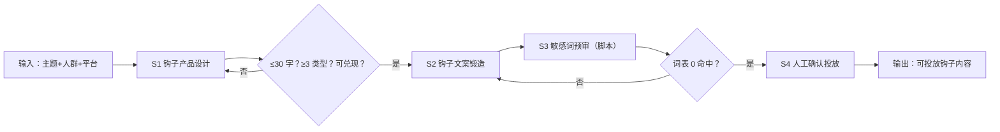

# 引流钩子内容生成

## 元信息

| 字段 | 值 |
|------|-----|
| ID | `de_media_04_wf01` |
| 类型 | **`composite`（复合技能）** |
| 所属员工 | 引流转化师 |
| 阶段 | `P1` |
| 复杂度 | `S` |
| 触发方式 | 人工（按活动） |
| ROI | 钩子设计外包市场价数百元/次，自产即省 |
| 资产形态 | 提示词编排 + Python 编排脚本（run_flow.py，无 API Key） |

> 复合技能 = 工作流。它把多个**原子技能**按业务顺序编排在一起，完成一个完整场景。

## 能力描述

把一个引流主题推进到「可投放的钩子内容」，四步走：

1. **S1 钩子产品设计**：产出 8-10 条资料包/清单/测评类钩子候选，单条 ≤30 字，覆盖 ≥3 种类型，内容必须可兑现
2. **S2 钩子文案锻造**：候选扩写为朋友圈/社群投放文案，正文 120-200 字，首句 ≤20 字，每条只放 1 个行动指令
3. **S3 敏感词预审**（脚本承担）：逐条扫描极限词词表（最好/第一/100%/国家级等），命中即拦截；序数用法（如「第一周」）不算
4. **S4 人工确认**：预审通过后由运营选定 1-2 条投放，引流路径须真实可达

## 编排的原子技能

| # | 原子技能 | 能力 |
|---|---------|------|
| 1 | [钩子产品设计](../../skills/hook-product-design/) | 设计资料包/清单/测评类引流钩子 |
| 2 | [钩子文案锻造](https://github.com/bangwozuo/script-writer-zh/tree/main/skills/hook-copy-craft/)（跨仓技能） | 生成黄金 3 秒开场钩子变体 |
| 3 | [敏感词预审](https://github.com/bangwozuo/script-writer-zh/tree/main/skills/sensitive-word-precheck/)（跨仓技能） | 平台敏感词/违禁词校验 |

## 步骤链路（DAG）



## 步骤明细

| # | 步骤 | 技能资产 | 输入 | 输出 | 失败处理 |
|---|------|---------|------|------|---------|
| 1 | 钩子产品设计 | [`../../skills/hook-product-design/`](../../skills/hook-product-design/) | 主题+人群+平台 | 8-10 条钩子候选 | 超 30 字/类型不足/不可兑现 → 退回重出 |
| 2 | 钩子文案锻造 | 钩子文案锻造（跨仓） | 定稿钩子 | 投放文案 3 条 | 正文超 200 字拆条；无行动指令退回 |
| 3 | 敏感词预审 | 敏感词预审（跨仓）+ 本流脚本 | 全部文案 | 逐条核查结论 | 命中词表 → 拦截改写后复检 |
| 4 | 人工确认 | （人工） | 核查结论 | 选定投放内容 | 预审不通过不得投放 |

## 步骤说明

定位目标人群→设计资料包/清单/测评钩子→扩写投放文案→合规校验→人工确认

## 输入规格

| 字段 | 类型 | 必填 | 说明 |
|------|------|------|------|
| `input` | string | ✅ | 工作流初始输入：主题（含引流品名称与构成）、目标人群、发布平台、引流目标 |

## 输出规格

| 字段 | 类型 | 说明 |
|------|------|------|
| `summary` | string | 执行摘要（候选数、文案数、预审通过率） |
| `steps` | array | 分步结果（每步资产、输出与量化验收） |
| `deliverable` | string | 最终交付物：钩子候选表 + 投放文案 + 预审结论 |
| 产物 | file | `out/引流钩子交付物.md`、`out/敏感词核查.csv`、`out/flow_result.json` |

## 错误处理

| 情况 | 处理方式 |
|------|---------|
| 输入缺主题/人群 | 提示缺少的字段，终止流程 |
| 钩子超 30 字或类型 <3 种 | 退回 S1 重出，注明原因 |
| 敏感词命中 | 拦截该条，改写后重新预审；序数用法（第一周）除外 |
| 引流品内容与钩子承诺不符 | 删除该钩子，不做「先吸引再说」设计 |

## 验收标准

- [ ] 钩子候选 ≥3 条、单条 ≤30 字、类型 ≥3 种
- [ ] 每条投放文案 120-200 字、含唯一行动指令
- [ ] 敏感词预审 0 命中（或拦截项已改写复检）
- [ ] 末步输出带 AI 生成标识，人工确认后才投放

## 使用步骤

### 方式一：纯提示词编排（跨平台）

1. 把 `prompt.txt` 全文粘贴为系统提示词
2. 提供主题、人群、平台与引流目标
3. 按 S1→S2→S3 顺序产出并自检
4. S3 的词表扫描用下方脚本实测，不靠模型自评

### 方式二：带脚本（端到端产物）

```bash
python <WF_DIR>/scripts/run_flow.py --input examples/input.json --outdir out
python <WF_DIR>/scripts/run_flow.py --demo   # 无输入也能看效果
```

**分工**：脚本做**钩子模板生成、文案组装、敏感词词表扫描、产物落盘**；模型做**钩子语境化润色、人群痛点深化**。词表核查结果一律以脚本输出为准。

## 调用示例

**输入**（`examples/input.json`，真实实跑数据）：《自律孩子 21 天习惯打卡表》资料包，微信 28-40 岁妈妈群体，朋友圈+微信群投放，目标扫码加企微。

**输出**（脚本实跑）：4 条钩子候选（13-30 字）+ 3 条投放文案，敏感词预审通过 3/3。

| # | 类型 | 钩子 | 预审 |
|---|---|---|---|
| 1 | 资料包型 | 21 天习惯打卡表，免费领 | ✅ 通过 |
| 2 | 清单型 | 孩子习惯养不成？先用这张「打卡表」自查 | ✅ 通过 |
| 3 | 反差型 | 不是孩子不自觉，是打卡姿势不对 | ✅ 通过 |

## 边界（不做的事）

- ❌ 不设计无法兑现的钩子——承诺内容必须在主题中真实存在
- ❌ 不跳过敏感词预审交付——「感觉没问题」不算预审
- ❌ 不做收益承诺类表达（涨粉 10 倍、稳赚等）直接拦截
- ❌ 不保证钩子投放后的转化率数据
- ❌ 不跳过人工确认环节

## 在平台上的编排方式

| 平台 | 编排方式 |
|------|---------|
| **Coze / 扣子** | 新建工作流 → 按步骤添加节点，每个节点填入对应技能的 prompt.txt |
| **Dify** | 新建 Workflow → 添加 LLM 节点链，按 DAG 顺序连接 |
| **WorkBuddy** | 新建 Skill，按步骤在指令中串联各技能提示词 |
| **手动使用** | 按步骤顺序，逐个把 prompt.txt 与上一步输出交给 AI |

## 所属工作流

本资产为复合技能（工作流），是私域引流的端到端入口；下游接
`welcome-7day-nurture-sop-flow`（新粉培育）与 `private-domain-calendar-flow`（内容排期）。

## 合规声明

- 输出标注「AI 生成内容」；投放前必须经运营人工确认
- 钩子不承诺兑现不了的效果；引流路径真实可达，不设虚假入口
- 不使用违反《广告法》的极限词；预审词表覆盖 14 类高危表达
- 本流程只到「可投放内容」为止，不执行自动发布
