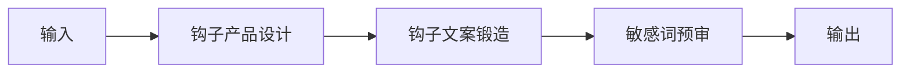

# 引流钩子内容生成

## 元信息

| 字段 | 值 |
|------|-----|
| ID | `de_media_04_wf01` |
| 类型 | **`composite`（复合技能）** |
| 所属员工 | 引流转化师 |
| 阶段 | `P1` |
| 复杂度 | `S` |
| 触发方式 | 人工（按活动） |
| ROI | 钩子设计外包市场价数百元/次，自产即省 |
| 资产形态 | 纯提示词（无运行时依赖） |

> 复合技能 = 工作流。它把多个**原子技能**按业务顺序编排在一起，完成一个完整场景。

## 编排的原子技能

| # | 原子技能 | 能力 |
|---|---------|------|
| 1 | [钩子产品设计](../../skills/hook-product-design/) | 设计资料包/清单/测评类引流钩子 |
| 2 | [钩子文案锻造](https://github.com/bangwozuo/script-writer-zh/tree/main/skills/hook-copy-craft/)（跨仓技能） | 生成黄金 3 秒开场钩子变体 |
| 3 | [敏感词预审](https://github.com/bangwozuo/script-writer-zh/tree/main/skills/sensitive-word-precheck/)（跨仓技能） | 平台敏感词/违禁词校验 |

## 步骤链路（DAG）



## 步骤明细

| # | 步骤 | 技能资产 | 输入 | 输出 | 失败处理 |
|---|------|---------|------|------|---------|
| 1 | 钩子产品设计 | [`../../skills/hook-product-design/`](../../skills/hook-product-design/) | 上一步输出 | 钩子产品设计 输出 | 记录错误并中止 |
| 2 | 钩子文案锻造 | [`https://github.com/bangwozuo/script-writer-zh/tree/main/skills/hook-copy-craft/`](https://github.com/bangwozuo/script-writer-zh/tree/main/skills/hook-copy-craft/) | 上一步输出 | 钩子文案锻造 输出 | 记录错误并中止 |
| 3 | 敏感词预审 | [`https://github.com/bangwozuo/script-writer-zh/tree/main/skills/sensitive-word-precheck/`](https://github.com/bangwozuo/script-writer-zh/tree/main/skills/sensitive-word-precheck/) | 上一步输出 | 敏感词预审 输出 | 记录错误并中止 |

## 步骤说明

定位目标人群→设计资料包/清单/测评钩子→合规校验

## 输入规格

| 字段 | 类型 | 必填 | 说明 |
|------|------|------|------|
| `input` | string / object | ✅ | 工作流初始输入，由触发条件提供 |

## 输出规格

| 字段 | 类型 | 说明 |
|------|------|------|
| `summary` | string | 执行摘要 |
| `steps` | string | 分步结果 |
| `deliverable` | string | 最终交付物 |

## 错误处理

| 情况 | 处理方式 |
|------|---------|
| 输入缺失 | 提示缺少的字段，终止流程 |
| 中间步骤输出不合规 | 合规技能拦截，返回修改建议，不继续下游 |
| 提示词被平台截断 | 拆分任务，分两次处理 |

## 验收标准

- [ ] 每一步的技能资产齐全（SKILL.md / prompt.txt / schema.json）
- [ ] 步骤间输入输出字段可衔接
- [ ] 末步输出带 AI 生成标识
- [ ] 全流程有人工确认环节

## 在平台上的编排方式

| 平台 | 编排方式 |
|------|---------|
| **Coze / 扣子** | 新建工作流 → 按步骤添加节点，每个节点填入对应技能的 prompt.txt |
| **Dify** | 新建 Workflow → 添加 LLM 节点链，按 DAG 顺序连接 |
| **WorkBuddy** | 新建 Skill，按步骤在指令中串联各技能提示词 |
| **手动使用** | 按步骤顺序，逐个把 prompt.txt 与上一步输出交给 AI |

## 使用示例

```text
第 1 步：把「钩子产品设计」的 prompt.txt 粘贴到 AI，
         提供输入数据，得到输出 A。

第 2 步：把「钩子文案锻造」的 prompt.txt 粘贴到新的对话，
         把输出 A 作为输入，得到输出 B。

…依次类推，直到末步。
```

---

*本复合技能定义由 build_p0_assets.py 生成*
