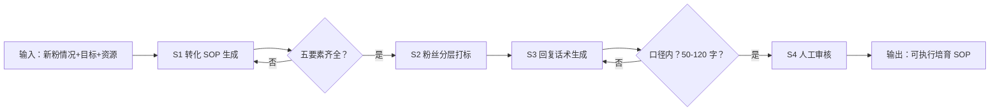

# 欢迎语与 7 天培育 SOP

## 元信息

| 字段 | 值 |
|------|-----|
| ID | `de_media_04_wf02` |
| 类型 | **`composite`（复合技能）** |
| 所属员工 | 引流转化师 |
| 阶段 | `P1` |
| 复杂度 | `M` |
| 触发方式 | 事件（新粉加入） |
| ROI | 替代人工逐一维护，月省约 15h；转化率每 +1pct 对知识付费创作者即数百元月增收 |
| 资产形态 | 提示词编排 + Python 编排脚本（run_flow.py，无 API Key） |

> 复合技能 = 工作流。它把多个**原子技能**按业务顺序编排在一起，完成一个完整场景。

## 能力描述

把一批新粉推进到「分层培育中的状态」，四步走：

1. **S1 转化 SOP 生成**：产出 D1-D7 培育排期，每步五要素齐全（渠道/动作/话术/负责人/验收指标），单人日执行动作 ≤6 项
2. **S2 粉丝分层打标**：按 7 天内互动/付费信号做动态分层（高意向/观望/沉默），每层配触达策略；参考占比（20%/50%/30%）须以实际数据复算修正
3. **S3 回复话术生成**：欢迎语与关键节点（D1/D3/D5/D7）话术，每条 50-120 字，可承诺口径外不承诺
4. **S4 人工审核**：SOP 与话术经运营负责人审核后进入执行，触达频次企微每日 ≤2 次

## 编排的原子技能

| # | 原子技能 | 能力 |
|---|---------|------|
| 1 | [转化 SOP 生成](../../skills/conversion-sop-generate/) | 生成 7 天/30 天培育触达剧本 |
| 2 | [粉丝分层打标](../../skills/fan-segmentation-tag/) | 按维度权重打分并分层 |
| 3 | [回复话术生成](https://github.com/bangwozuo/engagement-ops-zh/tree/main/skills/reply-script-generate/)（跨仓技能） | 按人设批量生成回复草稿 |

## 步骤链路（DAG）



## 步骤明细

| # | 步骤 | 技能资产 | 输入 | 输出 | 失败处理 |
|---|------|---------|------|------|---------|
| 1 | 转化 SOP 生成 | [`../../skills/conversion-sop-generate/`](../../skills/conversion-sop-generate/) | 目标+资源+对象 | D1-D7 排期表 | 缺要素退回补齐；单人日动作 >6 项合并 |
| 2 | 粉丝分层打标 | [`../../skills/fan-segmentation-tag/`](../../skills/fan-segmentation-tag/) | 上一步输出 | 动态分层与策略 | 信号不足时按观望层处理并标注假设 |
| 3 | 回复话术生成 | 回复话术生成（跨仓） | 分层+节点 | 节点话术 | 超 120 字拆条；口径外承诺退回 |
| 4 | 人工审核 | （人工） | SOP+话术 | 可执行方案 | 频次超标或承诺越界必须修改 |

## 步骤说明

新粉分层→7 天触达剧本→节点话术→人工审核执行

## 输入规格

| 字段 | 类型 | 必填 | 说明 |
|------|------|------|------|
| `input` | string | ✅ | 工作流初始输入：新粉情况（人数、来源、画像）、业务目标（转化口径）、可用资源（人力/预算） |

## 输出规格

| 字段 | 类型 | 说明 |
|------|------|------|
| `summary` | string | 执行摘要（SOP 步数、分层数、话术条数、目标转化率） |
| `steps` | array | 分步结果（每步资产、输出与量化验收） |
| `deliverable` | string | 最终交付物：D1-D7 SOP + 分层规则 + 节点话术 |
| 产物 | file | `out/培育交付物.md`、`out/7天培育SOP.csv`、`out/flow_result.json` |

## 错误处理

| 情况 | 处理方式 |
|------|---------|
| 输入缺新粉人数或目标 | 提示缺少的字段，终止流程 |
| SOP 步骤缺要素 | 退回 S1 补齐后再进 S2 |
| 话术超出可承诺口径 | 退回 S3 改写，明确升级人工的触发条件 |
| 触达频次超平台规则 | 合并触点；企微每日 ≤2 次、群发每周 ≤2 次 |

## 验收标准

- [ ] D1-D7 每步五要素齐全，单人日执行动作 ≤6 项
- [ ] 关键节点带量化验收（欢迎语 10 分钟送达率 100%、D3 覆盖率 ≥80%、D7 转化率 ≥5%）
- [ ] 分层策略基于信号且标注假设口径
- [ ] 每条话术 50-120 字、口径内承诺、带 AI 生成标识
- [ ] 全流程经运营负责人人工审核

## 使用步骤

### 方式一：纯提示词编排（跨平台）

1. 把 `prompt.txt` 全文粘贴为系统提示词
2. 提供新粉情况、业务目标与可用资源
3. 按 S1→S2→S3 顺序产出并自检
4. 分层比例与转化目标用实际数据复算，不靠模型口算

### 方式二：带脚本（端到端产物）

```bash
python <WF_DIR>/scripts/run_flow.py --input examples/input.json --outdir out
python <WF_DIR>/scripts/run_flow.py --demo   # 无输入也能看效果
```

**分工**：脚本做**SOP 排期生成、分层规则计算、话术模板组装、产物落盘**；模型做**话术语境化润色、人群痛点深化**。排期与验收口径以脚本输出为准。

## 调用示例

**输入**（`examples/input.json`，真实实跑数据）：7 天新增 156 名新粉（《幼儿园手册模板包》引流），25-38 岁妈妈群体，目标推动 399 元体验课付款，运营 1 人 + 助教 1 人。

**输出**（脚本实跑）：D1-D7 共 8 步 SOP、动态分层 3 层、节点话术 4 条。

| 阶段 | 动作 | 验收指标 |
|---|---|---|
| D1 | 发欢迎语+模板包领取引导 | 送达率 100% |
| D3 | 1 对 1 需求诊断（3 问清单） | 覆盖率 ≥80% |
| D7 | 优惠提醒 + 结营倒计时 | 付款转化率 ≥5%（约 8 人） |

## 边界（不做的事）

- ❌ 不执行自动发送——只产出 SOP 与话术草稿
- ❌ 不承诺转化率结果——≥5% 是执行目标，不是效果保证
- ❌ 不做口径外承诺（减免、赔付）；此类一律升级人工
- ❌ 不对沉默层无限触达——14 天无响应停止主动投入
- ❌ 不跳过人工审核直接进入执行

## 在平台上的编排方式

| 平台 | 编排方式 |
|------|---------|
| **Coze / 扣子** | 新建工作流 → 按步骤添加节点，每个节点填入对应技能的 prompt.txt |
| **Dify** | 新建 Workflow → 添加 LLM 节点链，按 DAG 顺序连接 |
| **WorkBuddy** | 新建 Skill，按步骤在指令中串联各技能提示词 |
| **手动使用** | 按步骤顺序，逐个把 prompt.txt 与上一步输出交给 AI |

## 所属工作流

本资产为复合技能（工作流），上游接 `traffic-hook-content-flow`（引流加粉），
下游接 `closing-repurchase-remind-flow`（成交与复购）。

## 合规声明

- 输出标注「AI 生成内容」；SOP 与话术执行前必须经运营负责人人工审核
- 触达频次遵守平台规则：企微 1 对 1 每日 ≤2 次、群发每周 ≤2 次
- 新粉数据属个人信息：分层只做统计，不输出手机号等敏感字段
- 不承诺转化效果；涉及资金的输出仅生成草稿，不执行写操作
