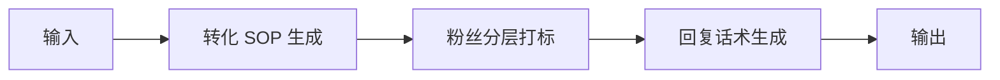

# 欢迎语与 7 天培育 SOP

## 元信息

| 字段 | 值 |
|------|-----|
| ID | `de_media_04_wf02` |
| 类型 | **`composite`（复合技能）** |
| 所属员工 | 引流转化师 |
| 阶段 | `P1` |
| 复杂度 | `M` |
| 触发方式 | 事件（新粉加入） |
| ROI | 替代人工逐一维护，月省约 15h；转化率每 +1pct 对知识付费创作者即数百元月增收 |
| 资产形态 | 纯提示词（无运行时依赖） |

> 复合技能 = 工作流。它把多个**原子技能**按业务顺序编排在一起，完成一个完整场景。

## 编排的原子技能

| # | 原子技能 | 能力 |
|---|---------|------|
| 1 | [转化 SOP 生成](../../skills/conversion-sop-generate/) | 生成 7 天/30 天培育触达剧本 |
| 2 | [粉丝分层打标](../../skills/fan-segmentation-tag/) | 见智能体 3 |
| 3 | [回复话术生成](https://github.com/bangwozuo/engagement-ops-zh/tree/main/skills/reply-script-generate/)（跨仓技能） | 按人设批量生成回复草稿 |

## 步骤链路（DAG）



## 步骤明细

| # | 步骤 | 技能资产 | 输入 | 输出 | 失败处理 |
|---|------|---------|------|------|---------|
| 1 | 转化 SOP 生成 | [`../../skills/conversion-sop-generate/`](../../skills/conversion-sop-generate/) | 上一步输出 | 转化 SOP 生成 输出 | 记录错误并中止 |
| 2 | 粉丝分层打标 | [`../../skills/fan-segmentation-tag/`](../../skills/fan-segmentation-tag/) | 上一步输出 | 粉丝分层打标 输出 | 记录错误并中止 |
| 3 | 回复话术生成 | [`https://github.com/bangwozuo/engagement-ops-zh/tree/main/skills/reply-script-generate/`](https://github.com/bangwozuo/engagement-ops-zh/tree/main/skills/reply-script-generate/) | 上一步输出 | 回复话术生成 输出 | 记录错误并中止 |

## 步骤说明

新粉分层→7 天触达剧本→节点话术

## 输入规格

| 字段 | 类型 | 必填 | 说明 |
|------|------|------|------|
| `input` | string / object | ✅ | 工作流初始输入，由触发条件提供 |

## 输出规格

| 字段 | 类型 | 说明 |
|------|------|------|
| `summary` | string | 执行摘要 |
| `steps` | string | 分步结果 |
| `deliverable` | string | 最终交付物 |

## 错误处理

| 情况 | 处理方式 |
|------|---------|
| 输入缺失 | 提示缺少的字段，终止流程 |
| 中间步骤输出不合规 | 合规技能拦截，返回修改建议，不继续下游 |
| 提示词被平台截断 | 拆分任务，分两次处理 |

## 验收标准

- [ ] 每一步的技能资产齐全（SKILL.md / prompt.txt / schema.json）
- [ ] 步骤间输入输出字段可衔接
- [ ] 末步输出带 AI 生成标识
- [ ] 全流程有人工确认环节

## 在平台上的编排方式

| 平台 | 编排方式 |
|------|---------|
| **Coze / 扣子** | 新建工作流 → 按步骤添加节点，每个节点填入对应技能的 prompt.txt |
| **Dify** | 新建 Workflow → 添加 LLM 节点链，按 DAG 顺序连接 |
| **WorkBuddy** | 新建 Skill，按步骤在指令中串联各技能提示词 |
| **手动使用** | 按步骤顺序，逐个把 prompt.txt 与上一步输出交给 AI |

## 使用示例

```text
第 1 步：把「转化 SOP 生成」的 prompt.txt 粘贴到 AI，
         提供输入数据，得到输出 A。

第 2 步：把「粉丝分层打标」的 prompt.txt 粘贴到新的对话，
         把输出 A 作为输入，得到输出 B。

…依次类推，直到末步。
```

---

*本复合技能定义由 build_p0_assets.py 生成*
